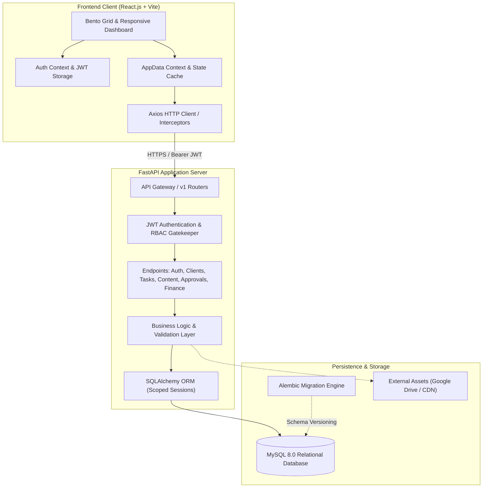
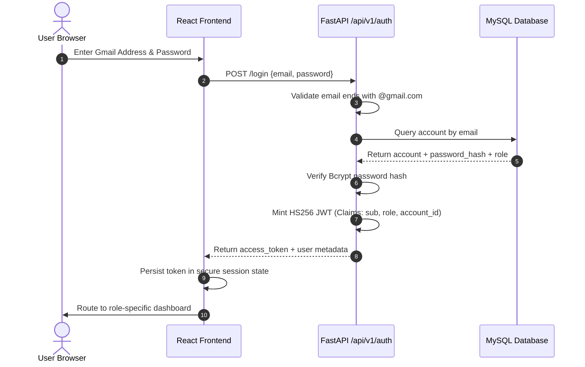
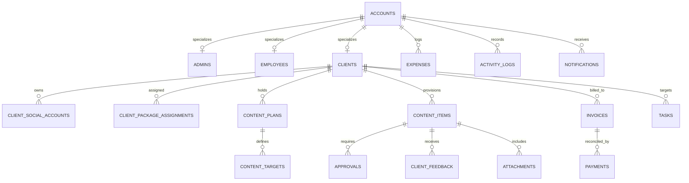

# SocialOps Architecture & System Design

This document details the architectural layout, entity models, security model, and primary business workflows of **SocialOps – Social Media Agency Management System**.

---

## 1. High-Level System Architecture

SocialOps is designed with a decoupled client-server architecture:

---

## 2. Authentication & Role-Based Access Control (RBAC)

### Multi-Tenancy & User Roles
SocialOps enforces strict three-tier role-based access control with Gmail domain verification:

| Role | Permissions & Boundaries |
| :--- | :--- |
| **Admin** | Full system visibility; manages agency employees, onboarded clients, service packages, deliverable templates, invoice dispatch, and financial metrics. |
| **Employee** | Creative production visibility; assigned deliverables, cross-client task boards, Google Drive asset submission, and internal operational expense logging. |
| **Client** | Strictly isolated tenant boundary; views assigned deliverables, brand profile guidelines, calendar schedules, reviews/approves content, and pays invoices. |

### Authentication Lifecycle

---

## 3. Database Entity Relationship Diagram (ERD)

The database schema models an agency ecosystem with table inheritance (ISA specialization for Account roles) and multi-tenant scoping:

---

## 4. Core Business Workflows

### A. Content Production & Client Approval Pipeline
1. **Creation**: Content item is scheduled in a Campaign Deliverable by Admin or Employee.
2. **Production**: Assigned employee creates visual or copy assets and attaches a validated Google Drive URL.
3. **Queue Ingestion**: The system automatically moves the item to the client's `Approval Queue` with a verification compliance hash.
4. **Client Review**: Client reviews the deliverable:
   - **Approve**: Deliverable is marked `Approved`, scheduled for publishing on the calendar, and an activity log is written.
   - **Request Revision**: Client inputs feedback comments; item moves back to `Needs Changes` state, alerting the assigned employee.

### B. Financial Operations & Payment Reconciliation
1. **Invoice Generation**: Admin dispatches an itemized invoice for monthly retainer deliverables with automatic subtotal, tax, and total computation.
2. **Client Notification**: Client receives real-time notification with balance due and payment due date.
3. **Reconciliation**: When payments (credit card, wire, or bank ACH) are recorded, the invoice's `paid_amount` and `balance_due` are recalculated in real time. Upon zero balance, invoice status transitions to `Paid`.

---

## 5. Security & Isolation Architecture

- **Domain Whitelist**: Only `@gmail.com` addresses are permitted across registration and authentication.
- **Tenant Isolation**: Every client-scoped query strictly filters by `client_account_id == current_user.account_id`, preventing cross-client data leaks.
- **Audit Logging**: Sensitive mutations (role alterations, payment recordings, approvals) automatically write tamper-evident records to `activity_logs`.
- **Sensitive Data Scrubbing**: Database passwords and JWT signing keys are managed exclusively via environment variables and excluded from version control.
